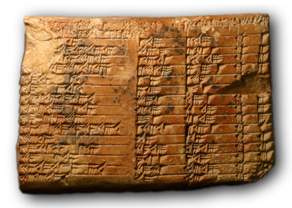
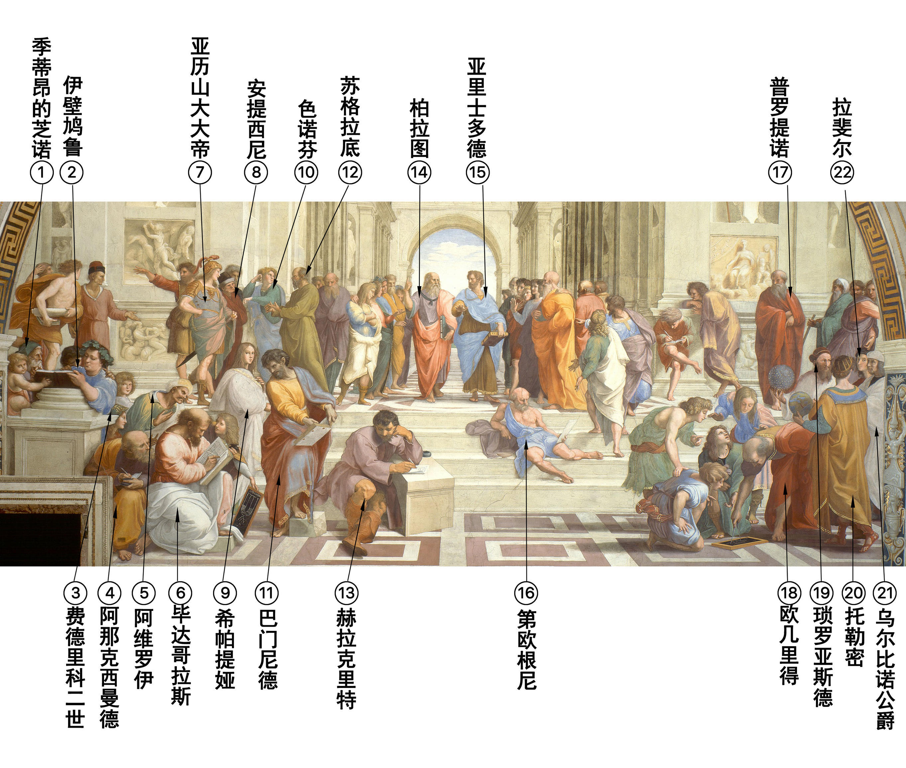
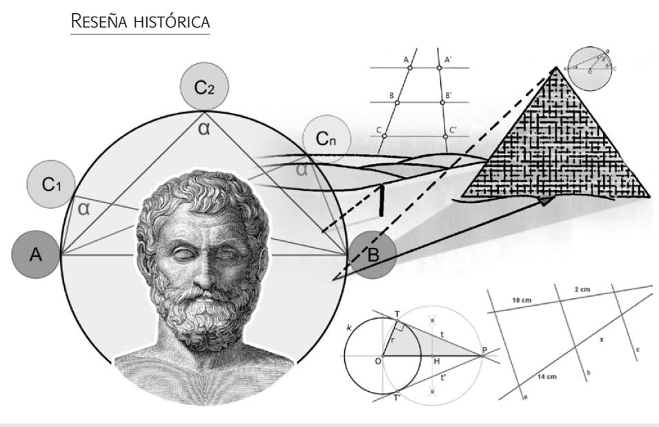
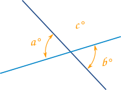
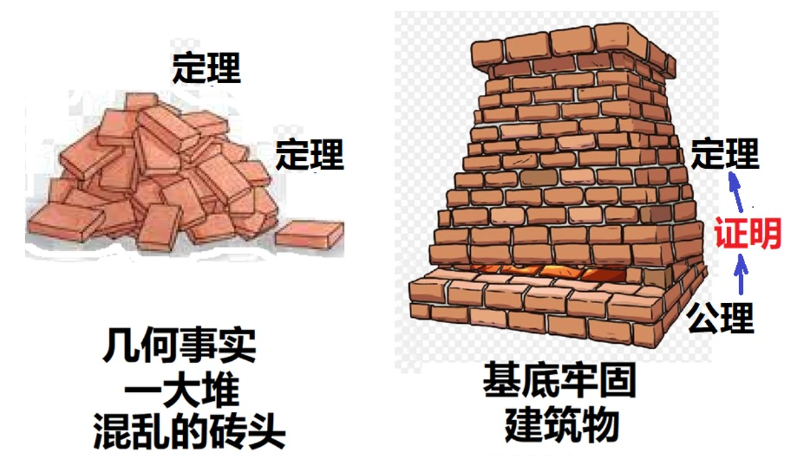
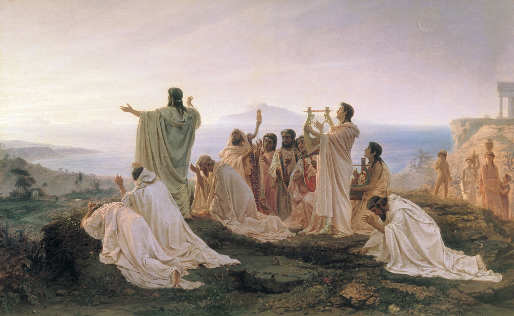
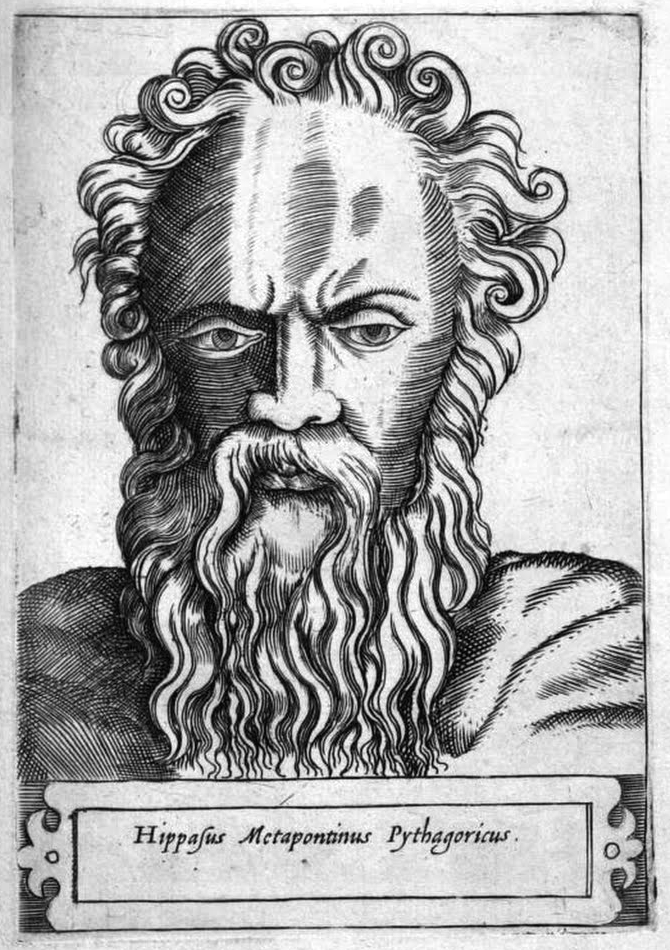

# 1.1 计算的进化

## 泥板上的算术

数学有着久远的历史。从原始社会开始，人类就在绳子上打结，以便记数；在地上画图，测量大小。“结绳记数”开创了数字的最早概念，“土地测量”等生产活动的需求，使几何学应运而生。

距今数千年前的古埃及和古巴比伦地区，已经出现了相当丰富的几何知识。例如图 1-1 所示的《普林顿 322》是一块古巴比伦泥板，上面的表格记录了多组勾股数，也就是满足 $a^2+b^2=c^2$ 的正整数 $a$、$b$、$c$。这些文献距今已近四千年，堪称人类最早的数学文明。

:::center
   
  图 1-1 古巴比伦泥板《普林顿 322》，约制作于公元前 1800 年，现藏于美国哥伦比亚大学。
:::

不过，这些“史前数学”留下的资料有限，许多成果的作者无从考证。若要追溯数学作为一门现代学科的起源，则要等到两千多年后的古希腊。

## 诸神眷顾的半岛

当今世界人口超过 70 亿。根据人类演化历史的研究，这几十亿人口，来源于一个共同的祖先“非洲人”。

后来，人类祖先以双脚走出非洲迁徙到世界各地，沿河聚居，建立城市和国家，几个文明古国先后出现。尽管多种人类文明独立诞生于不同的地区，各自特色不一，但作为人类文明思想精华之一的“科学”，却起源于唯一的一个地方：古希腊！

那么，科学为什么偏偏在古希腊萌芽？答案与古希腊的地理环境有关！

以“科学之父”泰勒斯的家乡米利都为例，它位于小亚细亚西岸，濒临爱琴海。曲折的海岸线、众多岛屿和天然港湾，为航海与贸易提供了便利。频繁的海上往来不仅带来了商品，也带来了埃及、巴比伦等古老文明的知识与思想。不同文明在这里碰撞、融合，孕育出一种独特的、带有鲜明海洋色彩的古希腊文明。

:::center
   
  图 1-2 米利都，古希腊哲学和早期科学的重要发源地之一，地处东西方交通要冲，南接埃及，东通巴比伦
:::

若要直观领略古希腊哲学家们的风采，最好的莫过于拉斐尔于 1509—1511 年在梵蒂冈宗座宫签字厅创作的传世名画《雅典学院》。拉斐尔将不同时代的哲学家、数学家和学者汇聚在同一座宏伟建筑中，构建出一座理想化的“知识殿堂”。

:::center
   
  图 1-2 《雅典学院》局部
:::

画面正中央是柏拉图和亚里士多德。柏拉图左手夹着《蒂迈欧篇》，右手指向天空，象征他所追求的理念世界；亚里士多德左手拿着《尼各马可伦理学》，右手掌心向下，象征他更关注现实世界与具体事物。两人的手势，形象地展现了古希腊哲学中两种不同的思想取向。

画面左侧，与身边人辩论的是苏格拉底；左下方低头研究数学与音乐比例关系的是毕达哥拉斯。右下方，欧几里得正俯身拿着圆规，为学生讲解几何。他的身后，手捧地球仪的是托勒密，旁边手持天球的是琐罗亚斯德。画面中央的台阶上，斜躺着一个看似与周围格格不入的人，他是古希腊犬儒学派的代表人物第欧根尼。传说他生活极为简朴，住在一个大陶瓮里。有一天，亚历山大大帝前来看望他，表示愿意满足他的任何愿望。第欧根尼却只说了一句：“请您让一让，别挡住我的阳光。”

《雅典学院》还藏了一个“彩蛋”：画面右下角的柱子旁，那个头戴黑帽、转头望向画外的人，正是拉斐尔本人。我们不妨想象一下他此刻的心声：“真遗憾啊，晚生了两千年！我多么希望能生活在那个群星璀璨的时代！”

虽然我们无缘亲历那个时代，但仍然可以也应该认识一些在哲学与科学萌芽时期作出开创性贡献的伟大思想家。

## 万物是可以被解释的

泰勒斯是米利都学派（Milesian school）[^1]的创始人，古希腊七贤之一，是历史上记载的第一个用观察和逻辑解释自然现象的人，被后人誉为“科学和哲学之父”。

:::center
   
  图 1-2 米利都的泰勒斯
:::

泰勒斯最著名的哲学观点是“水是万物之本”。这个学说在今人看来不免有些荒诞，却有着巨大的历史意义：

- 首先，在思想方法上，泰勒斯偏离了当时流行的神创万物的思路，用自然本身解释自然。考虑到今天仍有数以十亿计的人相信神创万物，这一步更显卓然。
- 其次，在认识方法上，泰勒斯试图从纷繁的现象背后找出一个共同的本原，以简单的原理解释复杂的世界。引用英国古典学者基托（H. D. F. Kitto）在《希腊人》中所说：：

:::tip 《希腊人》引文
在这里，我们看到了希腊思想一个恒久的特点：无论是物质世界还是道德世界，整个宇宙都必定是合理的，因而也是可知的；同时，它在本质上又是简单的。物质世界表面呈现出的纷繁多样，不过是一种表象。
:::

泰勒斯所创建的学派称为”米利都学派“。以今天的观点来看，泰勒斯的学说不免有些荒诞。

## 证明的诞生

泰勒斯在数学方面的划时代贡献，是将“证明”的思想引入几何研究。据后世记载，他曾证明过以下几何命题：

- 直径将圆二等分；
- 等腰三角形的两个底角相等；
- 两条直线相交时，对顶角相等；
- 两个三角形若有两角及其夹边分别相等，则全等；
- 直径所对的圆周角是直角。

这些命题未必都是泰勒斯首先发现的，古埃及人和巴比伦人很早就掌握了其中一些。以“两条直线相交时，对顶角相等”为例。在古希腊之前，人们大多把它看作显而易见的事实；如果有人怀疑，就把其中一个角剪下来，叠到另一个角上，以此说明两者相等。

证明提供了另一种方法。如下图所示，要证明 $\angle a=\angle b$，可以这样推理：$\angle a+\angle c$ 等于平角，$\angle b+\angle c$ 也等于平角；所有平角都相等，根据“等量减去等量，余量相等”，从两边同时减去 $\angle c$，便得到 $\angle a=\angle b$。

:::center
   
  图 对顶角相等的证明
:::

与凭经验得出结论相比，证明的意义主要体现在两个方面：

- 其一，**证明能够确认定理的普适性**。例如，泰勒斯定理指出“直径所对的圆周角是直角”。如果没有经过证明，我们只能知道这个结论在某些情况下成立，无法确定它是否适用于所有情况；只有通过严格的推理，才能确认这里的“圆周角”指的是任意一个由直径所对的圆周角。
- 其二，**证明能够揭示不同几何事实之间的内在联系**。一个结论可以从另一个结论推导出来，已经证明的定理又可以成为证明新定理的依据。如此层层递进，原本散落的几何知识便逐渐形成一个相互联系的理论体系。打个比方，未经证明的几何事实，就像散落在地上的一堆砖头；证明把这些砖头彼此连接起来，最终建成一座建筑。

:::center
   
  图 证明的意义
:::

米利都学派所处的时代，正值“哲学的童年”。如同孩童模仿成年人说话，难免流露出几分幼稚。比如，泰勒斯虽然提出了“万物的本原是水”，却又因磁石能够吸铁，认为它具有灵魂，并提出“万物皆有灵魂”的说法。所以，我们万万不可用现代人的眼光和标准，去苛求这些最早的思想家。如罗素在《西方哲学史》中所说：“米利都学派的重要性，不在于它的成就，而在于它所尝试的东西。”可以想象，再过几十年，今天许多被奉为真理的科学结论也可能被推翻，但科学的研究方法和理性精神，却会一代代传承下去。

## 万物皆数

大约公元前 570 年，毕达哥拉斯出生在商业繁荣的萨摩斯岛，父亲是一位富裕的商人。总体来说，人生开局相当顺利。20 岁左右，他前往米利都求学，希望拜泰勒斯为师。但两人相差五十多岁，此时的泰勒斯已年事已高，便建议他前往古埃及寻找智慧。

古埃及是数学发源地，公元前 3000 年那里的人们便开始使用数学，在那里最早出现了数字，也出现了第一部数学著作《莱因德纸草书》（公元前 1600 年）总之古埃及的数学非常辉煌，吸引毕达哥拉斯前往，学习几何、天文学和宗教知识。后来，波斯帝国征服埃及，身处埃及的毕达哥拉斯不幸被俘，并被带往巴比伦。真可算是命运的安排啊，地处美索不达米亚的古巴比伦（美索不达米亚文明是人类最早的文明），同样拥有辉煌的数学文明。早在一千多年前，巴比伦人便已掌握六十进位制，能够求解各类方程，计算各种图形的面积和体积。小有名气的毕达哥拉斯在那里并没有受到非人的待遇，五年的时间让他的数学更上一层楼。

至此，历时 19 年的旅程告一段落，集古埃及、巴比伦（有一种说法是他也曾去过古印度）的大成者，回到故乡萨摩斯，开始传经布道，广收弟子，建立了影响世界数千年的“**毕达哥拉斯学派**”。

据说，毕达哥拉斯述而不著，并禁止门徒外泄学说，因此他的生平和思想长期笼罩在神秘之中。这种神秘给后世留下了巨大的想象空间。后来，许多原本属于他人、甚至整个学派的思想和事迹，都被附会到他的身上，以至于他最终被神化为下凡救世的阿波罗神。毕达哥拉斯本人也自负地说：“世上既有人，也有神，还有像毕达哥拉斯这样的生物。”言外之意，自己是半神。

:::center
   
  图 费奥多尔·布罗尼科夫（Fyodor Bronnikov）所作《毕达哥拉斯学派庆祝日出》（1869）
:::

据说，学派有两句著名格言：“什么是智慧？只有数目。”“什么最美好？只有和谐。”在他们看来，宇宙万物都遵循数的规律，无论是音乐的和谐，还是天体的运行，都可以用数及其比例关系来解释。

毕达哥拉斯学派发现，琴弦发出的音高与弦长有关，而和谐的音程往往对应着简单的整数比例。例如，在琴弦材料、张力等条件相同的情况下，将琴弦的有效长度缩短一半，声音便升高一个八度；缩短至三分之二，则得到纯五度。原本依靠听觉感受的音乐和谐，竟然可以用如此简单的数学关系来解释。学派还将这一思想推广到天文学。他们认为，既然音乐的和谐可以用数的比例来解释，那么天体的运行也应当遵循某种数学秩序，由此产生了著名的 **“天体和谐”** 学说。在他们看来，整个宇宙如同一件巨大的乐器，天体按照特定的秩序运行，共同构成一种宏伟的和谐[^3]。

在对数与形的研究中，毕达哥拉斯学派的一项重要成就是证明了毕达哥拉斯定理（勾股定理）。在此之前，其他古代文明早已发现许多符合勾股关系的整数数组，称为“勾股数”。例如，(3, 4, 5)、(5, 12, 13)、(8, 15, 17)、(7, 24, 25) 等，中国古代的“勾三股四弦五”就是典型的例子。早在公元前 18 世纪，古巴比伦泥板上就已记录了多组勾股数。然而，发现勾股数，不等于发现勾股定理，更不等于证明了勾股定理。 后者的意义在于，通过逻辑推理，将有限的经验发现上升为具有普遍性的数学定理。

:::tip 毕达哥拉斯定理

毕达哥拉斯学派并没有留下可考的书面著作。现存文献中，勾股定理最早的严格证明见于欧几里得的《几何原本》。普罗克洛斯（Proclus，410—485）为《几何原本》作注时，将定理证明归功于毕达哥拉斯，这一定理便逐渐以他的名字流传下来。

:::

除了诸如证明勾股定理这种具体的贡献之外，毕氏学派当时最著名的数学思想是用原子论的观点，将几何建于算术（整数）之上。根据毕达哥拉斯学派的观点，一切数都可以用整数以及整数的比值（即我们现在所说的“有理数”）表示出来。

原子论认为，物质不断分割下去，最终会得到不可再分的原子；而毕达哥拉斯学派则认为，线段不断分割下去，最终会得到“点”。点是什么呢？就是构成几何图形的最小单位，如同物质中的原子一样，虽然很小，但仍具有一定的大小。换言之，在他们看来，线段就像一串珍珠，由许多具有一定大小的点排列而成。既然所有线段都由这样的基本单位组成，那么任意两条线段都可以公度（或称通约），即它们的长度之比都可以表示为两个整数之比。因此，世界及宇宙的美妙与和谐就建立在整数的基础之上！

在毕达哥拉斯之前，古希腊自然哲学家所说的万物本原，无论是水、气还是火，终究都是可以通过感官认识的具体物质。但毕达哥拉斯所说的“数”是什么？自然界中找不到一个叫作“数”的东西。数虽然不属于任何具体物质，却又普遍存在于万物的数量关系之中。从这个角度看，毕达哥拉斯的数本原说，将哲学提高到了一个新的层次，使人们开始超越感官经验，通过抽象思维探寻事物背后的本质和规律。

## 演绎推理的兴起

谁知好景不长，毕达哥拉斯的一位学生希帕索斯发现了 $\sqrt{2}$ 这种无法用整数或整数之比来表示的数（之后被称为“无理数”）。

事实上，从毕氏学派证明了的勾股定理，是很容易发现无理数的。一个边长为 1 的正方形，其对角线便不能与边长通约，长度记为 $\sqrt{2}$ 。类似情形还有很多很多，那么毕氏学派是如何确认所有正方形的对角线和变长都是不可通约呢？

如前所述，毕达哥拉斯学派坚信一切和谐皆可用整数及其比例表达。然而，正是他们引以为傲的毕达哥拉斯定理，带来了学派的噩梦——无理数。边长为 1 的正方形，其对角线长度无法表示为两个整数之比。这一发现动摇了学派的信仰，引发了数学史上的第一次数学危机。

相传，学派成员希帕索斯（Hippasus）试图找出一个等腰直角三角形，使三条边长都是自然数。因两直角边相等，可记其长为 $x$，斜边为 $y$。由毕达哥拉斯定理得 $x^2+x^2=y^2$，于是希帕索斯的问题转化为：是否存在自然数 $x$、$y$，使得 $2\times x^2=y^2$？

我们不妨先在 4 以内试一试（见表）。

:::center
表 4 以内 $x$ 与 $y$ 的可能性（笔者省略了部分，不然表格太长）
:::
|$x$| $y$ | $2\times x^2$|$y^2$|
|:--|:--|:--|:--|
|1|1|2|1|
|1|2|2|4|
|…|…|…|…|
|2|3|8|9|
|…|…|…|…|
|4|3|32|9|
|4|4|32|16|

在上表所有的情况里， $2\times x^2$ 都不等于 $y^2$。我们还可以在更大的数字范围内寻找，笔者相信毕达哥拉斯学派肯定找了很久，但没有找到解。后来，他们终于相信这个解不存在。

他们又是如何确信解不存在的呢？显然不可能靠遍历全部数对，因为这样的组合无穷无尽，即便搜遍 1,000、10,000，乃至 100 万，也不过是无穷中的有限一隅。让我们来重新构建一个新的思路，也许毕达哥拉斯学派就是由此得出结论。

我们先假定有解，看它会不会自相矛盾。大致过程如下：

:::tip 用反证法推理出矛盾的结论

假设 $\sqrt{2}$ 是有理数，则存在互质自然数 $p$ 和 $q$，使得：

$$
\sqrt{2} = \frac{p}{q}.
$$

两边平方：

$$
2 = \frac{p^2}{q^2} \quad \Rightarrow \quad p^2 = 2 q^2.
$$

由于只有偶数的平方是偶数，因此 $p$ 必为偶数，设 $p = 2s$，代入上式：

$$
p^2 = 4s^2 = 2 q^2 \quad \Rightarrow \quad q^2 = 2 s^2.
$$

所以 $q$ 也为偶数。

由于 $p$ 和 $q$ 皆为偶数，不互质。与前述互质的假设矛盾，因此原假设错误，**$\sqrt{2}$ 不是有理数**。

:::

上述证明收录于欧几里得的《几何原本》，是数学史上反证法最著名的应用之一。人们仅凭几个前提和严密的逻辑推理，就能证明某个结论绝不可能成立。这种研究对象和研究方法的变化，意味着数学开始摆脱对具体事物和实际计算的依赖，转而借助逻辑推理探索自身的规律。古希腊数学由此逐渐走上逻辑证明的道路，一个属于演绎推理的美妙世界由此展开。

不过，对于毕达哥拉斯学派来说，$\sqrt{2}$ 的出现首先不是惊喜，而是麻烦。他们还没有准备好放弃“整数及其比例构成世界基础”的观念。因此，据说当时他们将这些事实严格保密，缄口不言。不料，不识时务的希帕索斯偏偏把秘密捅了出去！这还了得？据传，愤怒的同门索性将他扔进大海喂鱼，以泄心头怨恨！

:::center
   
  图  《希帕索斯的雕版画》 可怜的希帕索斯，或许是历史上第一位为真理献身的人！
:::

不过是发现了两条不能通约的线段而已，有这么严重吗？就是这么严重！如果存在不可通约的线段，就没有公共的量度单位，便不能将“点”看成有长度的东西，毕氏学派“万物皆（整）数”的哲学思想立刻分崩离析，建立于美妙的整数之上的和谐宇宙也轰然倒塌了。人们自然便怀疑：数学还能成为一门精确的科学吗？宇宙的和谐与秩序是否依然存在？因此，无理数的发现，引发了数学史上的第一次危机。

第一次数学危机动摇了整数的崇高地位，也促使古希腊数学的基础逐渐从算术转向几何。在算术中，$\sqrt{2}$ 无法表示为整数之比；但在几何中，它却可以自然地表示为边长为 1 的正方形的对角线。借助线段、图形及其关系，古希腊人得以研究这些不可通约的量。

同时，这场危机也让古希腊人进一步认识到，直觉和经验未必可靠，数学结论需要严格的逻辑证明。此后，古希腊数学逐渐走向公理化，形成了以公理和逻辑证明为基础的演绎体系。

# 1.3 以“公理化”方法建立真理系统

第一个公理化的逻辑系统，是欧几里得的《几何原本》。

欧几里得（Euclid）被誉为“几何学之父”，约公元前 300 年活跃于埃及的亚历山大里亚。关于欧几里得的生平，流传至今的资料很少，有些研究者认为其实没有欧几里得这个人，他所写的作品其实是一群数学家（柏拉图的学生：欧多克索斯、泰阿泰德及欧普斯的腓力等）所写，归于“欧几里得”名下。

《几何原本》堪称数学史上最具影响力的著作，是用公理化方法建立演绎体系的经典范例。欧氏几何从五条公理出发，靠逻辑推理证明其他命题和定理，庞杂的几何知识由此形成一个相互联系的演绎体系。

:::tip 徐光启评价《几何原本》
能精此书者，无一事不可精；好学此书者，无一事不可学。
:::

所谓公理，是指在数学体系中无需证明、作为逻辑推理起点的基本命题。欧式几何的五条基本公理如下：

- 过任意两点，可以作一条直线（直线公理）。
- 任意线段可以无限延长。
- 以任意一点为圆心、任意长度为半径，可以作圆（圆公理）。
- 所有直角都相等（角公理）。
- 若一条直线与另外两条直线相交，使同侧内角之和小于两个直角，则这两条直线延长后必在该侧相交（平行公理）。

其中，第五条公理可以等价表述为：在同一平面内，过直线外一点，有且只有一条直线与已知直线平行。

## 非欧几何

欧几里得的五条公理中，人们对前四条都没有异议，唯独第五公理（平行公理）看起来颇似定理。在《几何原本》中，平行公理到证明第 29 个命题时才用到，之后也很少用。许多人因此怀疑：是不是四条公理就够了，平行公理也许可以被证明出来？

两千多年来，数学家们围绕第五公理反复争论、质疑和研究，始终没有结果。直到 1826 年，俄国数学家罗巴切夫斯基（下文简称罗氏）使用反证法，先假设第五公理不成立，即“过直线外一点可以作两条以上的平行线”，再结合前四条公理进行推理，试图从中找出逻辑矛盾。如果能够推导出矛盾，就说明假设错误，第五公理自然成立。但是，罗氏并没有从假设中推导出任何矛盾，反而得到了一系列与欧氏几何截然不同的定理，建立起一套与欧氏几何完全平行的几何体系——罗氏几何（称双曲几何）。

罗氏几何描述的是一个负曲率的弯曲空间，用下面的马鞍形曲面来直观理解（图 1-3）。

:::center
   
  图 1-3 曲面上的三角形三边向内凹，内角和小于两个直角；右下方的两条线同时垂直于一条线段，在欧氏几何中它们应当平行且保持等距，在这里却越离越远。
:::

罗氏几何完全不同于欧氏几何，开创了非欧几何的先河。一方面，这意味着欧几里得并不是随意选择了第五公理，他必须选择第五公理才能建立起欧氏几何。另一方面，这也意味着罗氏惹上了和哥白尼一样的大麻烦。哥白尼说地球不是宇宙中心，违反宗教教义被活活烧死。由于颠覆了当时大众广为认知的体系，罗氏的理论受到很多非议，他个人也遭受了很多不公正待遇，到死也没能看到自己的研究成果被学界公认[^1]。罗氏死后 12 年，即 1868 年，意大利数学家贝尔特拉米（Beltrami）发表论文《非欧几何解释的尝试》，证明非欧几何可以在欧氏空间的曲面上得到解释。也就是说，非欧几何中的命题可以“翻译”成相应的欧氏几何命题；如果欧氏几何没有逻辑矛盾，那么非欧几何也不会有矛盾。直到这时，长期无人问津的非欧几何才开始获得学术界的普遍注意，罗氏的独创性研究也由此得到高度评价，他本人则被誉为“几何学中的哥白尼”。

之后，数学家们对平行公理的进一步研究，最终衍生出三种逻辑自洽的几何学：欧氏几何、罗氏几何和球面几何（图 1-4，从左到右）。

:::center
   
  图 1-4 三种几何最直观的区别体现在三角形的内角和上：欧氏几何等于 180°，罗氏几何小于 180°，球面几何大于 180°
:::

再之后，德国数学家黎曼拓展了几何学的研究范围，将微积分引入弯曲空间的研究，建立了黎曼几何，使数学家能够用统一的方法研究不同维度、不同曲率的空间。他还提出，空间的几何性质可能受到物理作用的影响。半个多世纪后，爱因斯坦借助黎曼几何，将引力解释为物质和能量引起的时空弯曲，建立了广义相对论。

[^1]: 米利都学派兴起于公元前6世纪，以泰勒斯、阿那克西曼德和阿那克西美尼为代表。他们分别提出水、无定者和气是万物的本原，尝试用理性解释自然，开创了古希腊自然哲学的传统。
[^2]: 毕达哥拉斯学派的学说将音乐、天文学与算术、几何联系起来，使这四门学科有了共同的数学基础。直到中世纪，这四门学科依然被作为教士学习的基础课程，被称为 **“四艺”（Quadrivium）**。
[^3]: 1832 年，罗巴切夫斯基的论文遭到俄国科学院否定，随后又受到报刊公开嘲笑。晚年，他被解除喀山大学校长和教授职务，生活困顿，双目失明的情况下，以口述完成著作《泛几何学》后，于次年去世。