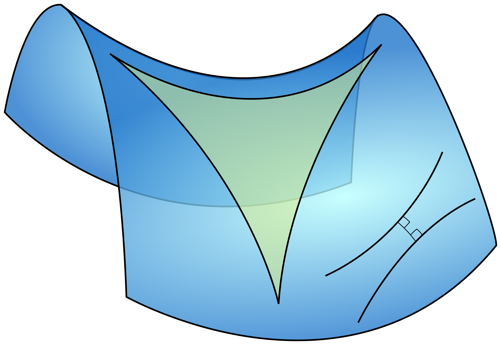
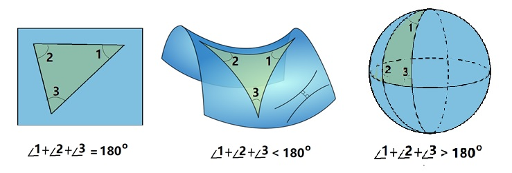

# 1.3 以公理建立真理系统

第一个公理化的逻辑系统，是欧几里得的《几何原本》。

:::tip 徐光启评价《几何原本》
能精此书者，无一事不可精；好学此书者，无一事不可学。
:::

欧几里得（Euclid）被誉为“几何学之父”，约公元前 300 年活跃于埃及的亚历山大里亚。关于欧几里得的生平，流传至今的资料很少，有些研究者认为其实没有欧几里得这个人，他所写的作品其实是一群数学家（柏拉图的学生：欧多克索斯、泰阿泰德及欧普斯的腓力等）所写，归于“欧几里得”名下。

《几何原本》堪称数学史上最具影响力的著作，是用公理化方法建立演绎体系的经典范例。欧氏几何从五条公理出发，靠逻辑推理证明其他命题和定理，庞杂的几何知识由此形成一个相互联系的演绎体系。

这 5 条公理如下：

- 过任意两点，可以作一条直线（直线公理）。
- 任意线段可以无限延长。
- 以任意一点为圆心、任意长度为半径，可以作圆（圆公理）。
- 所有直角都相等（角公理）。
- 两直线被第三条直线所截，如果同侧两内角和小于两个直角， 则两直线作会在该侧相交。（平行公理）。

任何读过上述五条公理的人，都会发现第五公理与前四条相比，表述实在过于复杂，读起来更像一条需要证明的定理，缺乏公理应有的自明性。因此，两千多年来，数学家们不断尝试从其他公理出发证明第五公理，却始终未能成功。

1826 年，俄国数学家罗巴切夫斯基（下文简称罗氏）换了一种思路：既然无法证明第五公理，假如它不成立，又会怎样？他保留欧氏几何的其他基本假设，用“过直线外一点，可以作不止一条与已知直线不相交的直线”代替第五公理，并以此展开推理。按照反证法的思路，如果由此推导出逻辑矛盾，就能反过来证明第五公理。然而，罗氏却得出了许多违背日常直觉的结论，例如三角形的内角和小于 180°，却始终没有发现逻辑矛盾。由此，罗氏建立了一套与欧氏几何并立的几何体系——罗氏几何，也称双曲几何。

罗氏几何描述的是一个负曲率的弯曲空间，用下面的马鞍形曲面来直观理解（图 1-3）。

:::center
   
  图 1-3 曲面上的三角形三边向内凹，内角和小于两个直角；右下方的两条线同时垂直于一条线段，在欧氏几何中它们应当平行且保持等距，在这里却越离越远。
:::

罗氏几何完全不同于欧氏几何，开创了非欧几何的先河。一方面，这意味着欧几里得的第五公设并不能由其他公设推导出来，他必须选择第五公理才能建立起欧氏几何。另一方面，这也意味着罗氏惹上了和哥白尼一样的大麻烦。哥白尼说地球不是宇宙中心，违反宗教教义被活活烧死。由于颠覆了当时大众广为认知的体系，罗氏的理论受到很多非议，他个人也遭受了很多不公正待遇，到死也没能看到自己的研究成果被学界公认[^1]。罗氏死后 12 年，即 1868 年，意大利数学家贝尔特拉米（Beltrami）发表《非欧几何解释的尝试》，证明非欧几何中的命题可以转化为相应的欧氏几何命题。如果欧氏几何不存在逻辑矛盾，那么非欧几何也不会产生矛盾。直到这时，长期无人问津的非欧几何开始受到学术界的普遍注意，罗氏的独创性研究由此得到高度评价，他本人被誉为“几何学中的哥白尼”。

之后，数学家们对平行公理的进一步研究，最终衍生出三种逻辑自洽的几何学：欧氏几何、罗氏几何和球面几何（图 1-4，从左到右）。

:::center
   
  图 1-4 三种几何最直观的区别体现在三角形的内角和上：欧氏几何等于 180°，罗氏几何小于 180°，球面几何大于 180°
:::

再之后，德国数学家黎曼将微积分引入弯曲空间的研究，建立了黎曼几何，使数学家能够用统一的方法研究不同维度、不同曲率的空间。他还提出，空间的几何性质可能受到物理作用的影响。半个多世纪后，爱因斯坦借助黎曼几何建立了广义相对论，将引力解释为物质和能量引起的时空弯曲，改变了牛顿以来人类对空间、时间和引力的认识。

[^1]: 1832 年，罗巴切夫斯基的论文遭到俄国科学院否定，随后又受到报刊公开嘲笑。晚年，他被解除喀山大学校长和教授职务，生活困顿，双目失明的情况下，以口述完成著作《泛几何学》后，于次年去世。
