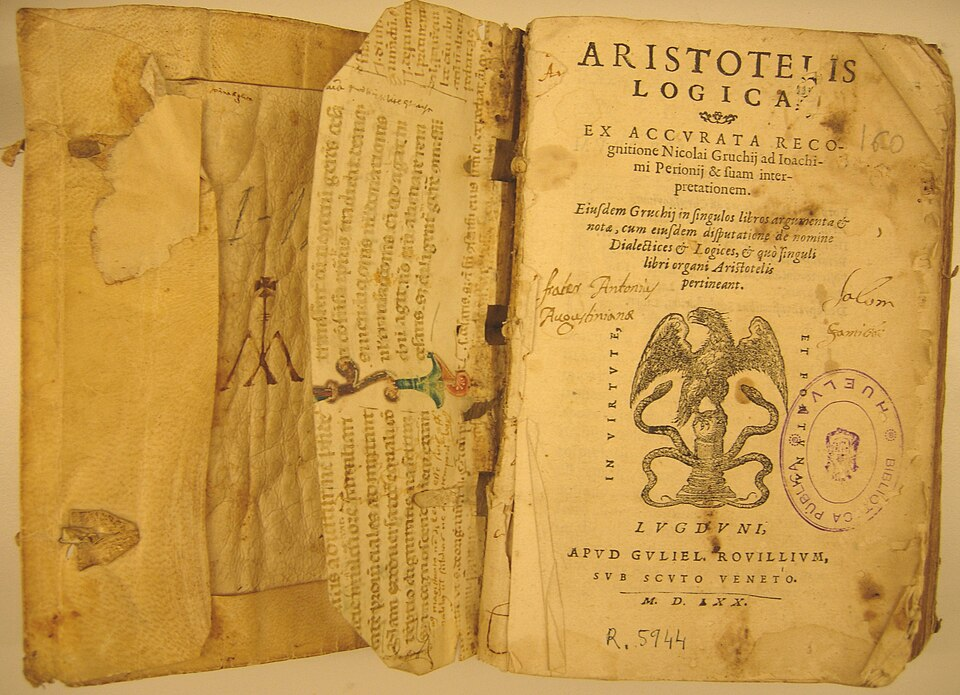
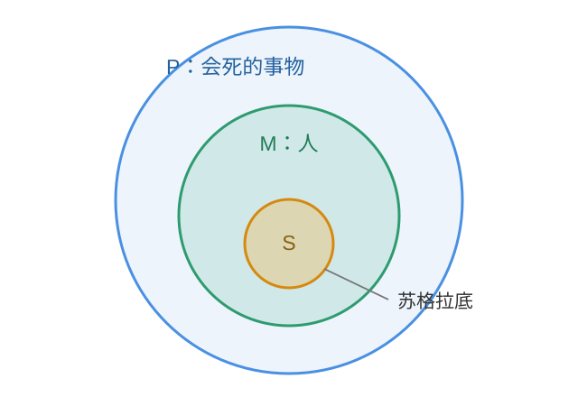

# 1.2 思维的形式化

所谓“推理”，就是从已知的前提出发，得出新的结论。要使推理过程严密可靠，必须遵循一定的规则。研究这些规则的学问，称之为“逻辑学”。

现代科学中所说的逻辑学，可以追溯至古希腊哲学家亚里士多德（Aristotle，公元前384—前322）。他在著作合集《工具论》（Organon）中系统建立了逻辑学说，奠定了西方逻辑学的基础，持续影响了西方思想两千余年。

:::center
   
  图 文艺复兴时期出版的《工具论》拉丁文合订本，封面印有“ARISTOTELIS LOGICA”（亚里士多德的逻辑）。
:::

亚里士多德在《工具论》中提出了传统逻辑学中最基本的推理形式——三段论（Syllogism）。笔者举一个几乎所有逻辑书都会引用的例子：

- 所有人都会死；（大前提）
- 苏格拉底是人；（小前提）
- 所以，苏格拉底会死。（结论）

在这个例子里，每句话都是一个“命题”（proposition）。前两句是前提，最后一句是结论。大前提陈述一条普遍原则，小前提指出一个符合该原则的特殊情况，结论则是这条原则落在该特殊情况上的必然结果。这种从普遍推向特殊的过程，是典型的演绎推理。

如果将完整的命题视为逻辑分析的最小单位，不再分析其内部结构，而是研究命题之间的逻辑关系，例如“如果 p，那么 q”“p 且 q”“如果 p 成立，且 p 蕴含 q，那么 q 成立”，这类逻辑就称为**命题逻辑**（Propositional Logic）。如果进一步分析命题的内部结构，将其拆分为主项、谓项、联项和量项，研究概念之间的逻辑关系，例如“所有 S 都是 P”“有些 S 不是 P”等，这类传统逻辑就称为**词项逻辑**（Term Logic）。其中，直接断定某类事物是否具有某种属性的命题，称为**直言命题**（Categorical Proposition），亚里士多德的三段论正是建立在直言命题形式之上。

按照词项逻辑的分析，亚里士多德用 S、M、P 三个符号代替“苏格拉底”“人”和“会死的”。其中，S 是小项，即结论的主项；P 是大项，即结论的谓项；M 是中项，在两个前提中各出现一次，起连接 S 与 P 的作用，结论中不再出现。这样一来，整个推理就可以写成：

$$
\begin{aligned}
&\text{所有 M 都是 P}\\
&\text{所有 S 都是 M}\\
&\therefore \text{所有 S 都是 P}
\end{aligned}
$$

（“苏格拉底”只指一个对象，传统逻辑把这类单称命题按全称命题处理。）从集合关系看，S 包含于 M，M 又包含于 P，所以 S 必然包含于 P。

:::center
   
  图：三段论的集合表示。S ⊆ M，M ⊆ P，因此 S ⊆ P
:::

用符号代替具体概念之后，三段论就不再受内容的限制：无论 S、M、P 代表什么，只要两个前提成立，结论就必然成立。换成“所有哲学家都是人”，结论就是“所有哲学家都会死”；换成“所有鲸都是哺乳动物”，结论就是“所有鲸都会死”。像这样只研究推理的结构、而不关心具体内容的逻辑，称为**形式逻辑**（Formal Logic）。

以三段论为代表的传统逻辑，研究的是词项之间的包含与排斥关系。但日常推理中还有另一类情形，并不涉及词项，例如“如果今天下雨，道路就会湿；今天下雨了，所以道路会湿”。这里起作用的不是“雨”和“路”这些概念，而是“如果……那么……”把两个命题连接起来的方式。把完整的命题作为基本单位，不再拆分其内部结构，只研究“如果 p，那么 q”“p 且 q”“p 或 q”这类命题之间的关系，这类逻辑就称为**命题逻辑**（Propositional Logic）。

命题逻辑由斯多亚学派（Stoicism）建立，集大成者是克律西波斯（Chrysippus，约公元前 280—前 207 年）。他归纳出五种最基本的推理形式，称为“不可证明式”，意思是它们本身无需证明，其他一切命题推理都可以化归为它们的组合。

| 推理形式 | 逻辑表达式 | 含义 |
|---|---|---|
| 肯定前件式 | $p\to q,\ p\ \therefore q$ | 如果 p 则 q，p 成立，所以 q |
| 否定后件式 | $p\to q,\ \neg q\ \therefore\neg p$ | 如果 p 则 q，q 不成立，所以 p 不成立 |
| 否定合取式 | $\neg(p\land q),\ p\ \therefore\neg q$ | p 和 q 不能同时成立，p 成立，所以 q 不成立 |
| 肯定否定式 | $p\oplus q,\ p\ \therefore\neg q$ | p 和 q 有且只有一个成立，p 成立，所以 q 不成立 |
| 否定肯定式 | $p\oplus q,\ \neg p\ \therefore q$ | p 和 q 有且只有一个成立，p 不成立，所以 q 成立 |

这些推理形式能够成立，背后有一条前提：任何命题要么真，要么假，没有第三种可能。这就是**排中律**（Law of Excluded Middle）。以否定肯定式为例，“p 不成立”之所以能推出“q 成立”，正是因为 p 与 q 之外别无选择。亚里士多德已经提出排中律，斯多亚学派则把它当作命题逻辑的基石，坚持每一个命题都有确定的真值，哪怕是关于未来的命题也不例外。

到这里的逻辑学，即由亚里士多德建立的词项逻辑以及克律西波斯完善的命题逻辑，在今天被称为“传统逻辑”（或者称古典逻辑）。传统逻辑持续统治了逻辑学 2000 年之久，人们一度认为，逻辑学已经发展到了尽头。著名哲学家康德（Immanuel Kant，1724—1804）断言：“逻辑学自亚里士多德以来，似乎未能向前迈进一步，因而看起来已经成为一门完备的学问。”但是在康德下完这个结论之后还不到一百年，逻辑学就发生了自其诞生两千多年以来最大的变革，这部分内容笔者将在下一篇讲述。

对于形式逻辑而言，即使推理形式正确，但前提错误也可能导致错误的结论。例如：

- 大前提：所有鱼都用鳃呼吸。
- 小前提：鲸鱼是鱼。
- 结论：所以，鲸鱼用鳃呼吸。

鲸鱼生活在水中，外形与鱼相似。但现代生物学已经明确，鲸鱼属于哺乳动物，用肺呼吸。因此，上述三段论虽然推理形式有效，但小前提不符合事实，得出了错误的结论。

三段论要从真实的前提得出可靠的结论，但前提的真实性又如何保证呢？亚里士多德认为，一切证明都必须从某些不需要进一步证明的基本原理出发，这些原理被称为“第一原理”（First Principles）。它们是知识和演绎推理的起点，也是后来公理化方法的重要思想基础。

在《后分析篇》中，亚里士多德区分了不同类型的基本原理：公理是不同学科可以共同使用的原则，例如矛盾律、排中律；定义用来说明概念的含义；假设则用于确认特定学科所研究的对象。各门学科从这些基本原理出发，通过演绎推理建立起自己的知识体系。

这一思想很可能受到古希腊几何学的影响。亚里士多德在论述中也大量引用几何学的例子。后来，欧几里得在《几何原本》中系统运用了这种方法，以定义、公设和公理为起点，逐步推导出一系列几何定理。

那么，这些不需要证明的第一原理又从何而来？

亚里士多德反对柏拉图的“灵魂回忆说”，认为知识始于感觉经验。人们通过感官获得知觉，知觉留下记忆，反复的记忆形成经验，再通过归纳与理智的认识，从个别事物中把握普遍原理。

这样一来，亚里士多德便将归纳与演绎联系起来：通过感觉经验和归纳认识普遍原理，再以这些原理为前提，通过演绎推理获得新的知识。