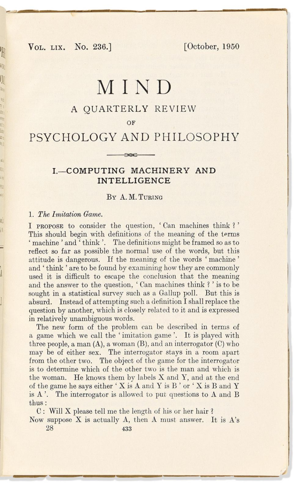
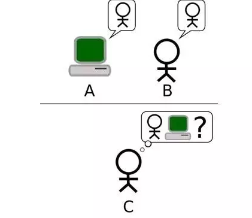
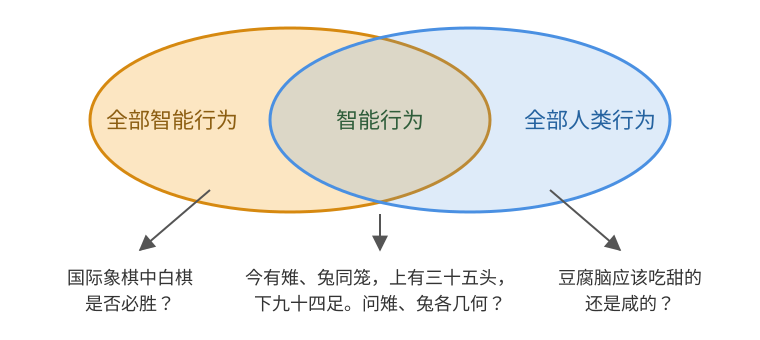
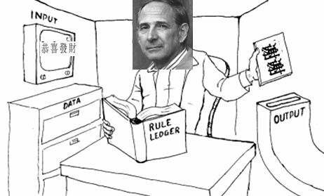

# 何为智能

1950 年，图灵在哲学期刊《心》（Mind）上发表一篇划时代的论文《计算机器与智能》（Computing Machinery and Intelligence），这篇论文被广泛认为是研究“机器智能”最早的奠基性文献。可以说，正是这篇图灵研究工作的总结，使得图灵被后人冠以“人工智能之父”的荣耀。

:::center
   
  图 图灵发表在《心》杂志上的论文
:::

文章的开头，图灵抛出了一个后来被反复引用的问题：**机器能思考么？**（Can machines think?）

但他很快指出，照这个问题的原始表述继续讨论下去，是走不通的。因为“机器”和“思考”这两个词在自然语言中缺乏清晰的边界，不同的人会根据各自的直觉、信仰或者哲学立场给出截然不同的理解。如果围绕词义本身展开讨论，讨论将陷入无休止的概念纠缠。既然很难给“思考”下一个准确的定义，图灵便换了一个思路：**与其争论机器究竟能不能思考，不如通过实验来判断机器能否表现得像人一样**。这便是著名的“模仿游戏”（Imitation Game），也称为“图灵测试”（Turing Test）。

图灵测试形式如图所示，核心想法是要求 **计算机在没有直接物理接触的情况下接受人类的询问，并尽可能把自己伪装成人类**。如果 **“足够多”** 的询问者在 **“足够长”** 的时间里无法以 **“足够高”** 的正确率辨别被询问者是机器还是人类，那么这台机器就有理由被认为具备某种意义上的“思考”能力。

:::center
   
  图 图灵测试：C 使用问题来判断 A 或 B 是人类还是机器
:::

但接下来的发展，恐怕连图灵本人都没有预料到，也许是因为图灵本身传奇般的名声，也许是因为测试形式简洁直观，或者人工智能领域本身就需要一个指向标，再加上媒体和文艺作品的不断渲染，图灵测试逐渐成了衡量人工智能水平的重要标尺。自 20 世纪 90 年代以来，每隔一段时间就有企业或机构出来声称自己研制的机器人（**包括 ChatGPT**）[^1]通过了图灵测试。然而，这些所谓的“通过测试”，无一例外全部是商业操作和宣传的噱头，都是在特定条件下，如“在 5 分钟”或者“ 20 句的对话”中，成功令若干个受测者认为与它对话的机器是个 13 岁的孩子。

有趣的是，因为机器在图灵测试上一次又一次的失败，人类基于机器通过这种测试的困难度，反而创造出图灵测试最广泛的应用场景，即在网络上随处可见的**验证码**。为了防止网站被自动化系统滥用，在网站上执行一些操作前，要求用户识别一张文字扭曲变形的图片。其背后的原因是，不存在能够稳定识别这些扭曲文字并理解其含义的自动化系统，能够做到这一点的就可以被认为是人类。

:::center
   
  图 问答式验证码：既要认出扭曲的文字，还要具备常识
:::

验证码的英文全称是 **Completely Automated Public Turing test to tell Computers and Humans Apart**，翻译过来是“全自动区分计算机和人类的图灵测试”。当你输入验证码时，实际上在参加一场“图灵测试”。只不过这一次，是由计算机来考人类，因此验证码也被称作“反向图灵测试”。

今天的主流人工智能研究，很少直接以通过图灵测试为目标。一方面，图灵测试本身难度极高；另一方面，图灵测试的目标不仅要求机器具备智能，还要求机器尽可能模仿人类。这就好比，人类不断改进飞机，目的是飞得更快、更远、更安全，而不是让飞机飞得像鸽子以至于能骗过其他鸽子。我们借助集合的关系，来理解“通过图灵测试的智能”与“人类所需的智能”两者的区别。如下图所示，定义“全部智能行为”和“全部人类行为”两个集合，以及二者的交集 —— 属于人类范畴的“智能行为”。

:::center
   
  图 智能行为与人类行为的关系
:::

- **属于全部智能行为可以回答的问题**：人类自身做不到的，例如算出国际象棋中白棋是否必胜；
- **属于智能行为可以回答的问题**：人类能够做到、也需要智能的，例如解鸡兔同笼问题；
- **属于全部人类行为可以回答的问题**：与智能无关，例如豆腐脑该吃甜的还是咸的。

显而易见，通过图灵测试的智能，需要能够尽可能地模仿全部人类行为。然而，并非所有人类行为都属于智能行为，也并非所有人类行为都有必要让计算机代替完成。比如，你完全没有必要让计算机替你判断“豆腐脑究竟该吃甜的还是咸的”。毕竟，喜欢哪种口味是个人偏好，谁也不会将这种问题用来衡量是否有智能以及作为衡量智能高低的依据。

## 中文屋实验

图灵测试提出后，很快成为人工智能领域最具影响力的思想实验之一。它为判断机器是否具有智能提供了一种行为主义标准：如果机器能够在交流中表现得与人类无异，那么我们是否有理由认为它具有智能？图灵的观点引来了不少哲学家的质疑，其中最著名的，是美国哲学家约翰·塞尔（John Searle）。1980 年，塞尔在《行为与脑科学》（Behavioral and Brain Sciences）杂志发表《心灵、大脑与程序》（Minds, Brains, and Programs）一文，提出“中文屋”思想实验反驳“程序即心智”的观点。

所谓“中文屋”（Chinese Room）的思想实验是这样的：

:::tip “中文屋”思想实验
假设有一个完全不懂中文的人，被关在一个封闭的房间里。房间里有一本用英文写成的手册（图中的 Rule Book），指导他如何处理收到的中文信息，以及如何用中文做出相应的回答。房外的人不断递进用中文写成的问题（图中的 INPUT，恭喜发财），房内的人则按照手册指示，查找合适的操作步骤，将中文字符组合成回答（图中的 OUTPUT，谢谢），再把答案递出去。
:::

从屋外的表现来看，人们会以为房内的人懂中文，但我们早就知道，他完全不理解中文，只是机械地按照规则操作符号。

:::center
   
  图 中文屋实验（头像是约翰·塞尔）
:::

在上述实验中，房外人的角色相当于程序员，房中人相当于计算机，而手册则相当于计算机程序，每当计算机接收到输入（计算指令），它便按照程序规则处理这些信息，并输出相应的结果。正如房中的“老外”不可能透过手册理解中文，计算机也不可能透过程序来获得理解力。既然计算机没有理解能力，所谓“机器能思考”便无从谈起了。

[^1]: 2026 年 10 月，期刊《科学哲学》发表了一篇题为《为什么至今没有人真正实施过图灵测试》的论文。研究人员尝试还原图灵最初的测试设计，取消五分钟的时间限制，允许测试者自由提问，直到有把握判断对方是否为机器。结果，37 名测试者中有 36 人成功识别出了机器（GPT-4-Turbo），平均用时约 14 分钟。